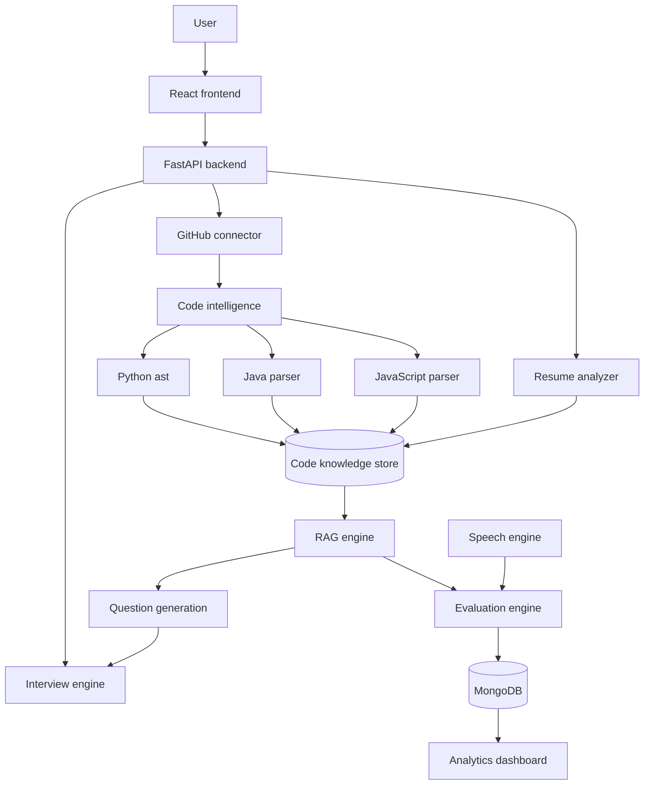

<div align="center">

# 🪞 Interview Mirror

### Know Your Code. Defend Your Work. Master Your Interview.

**An AI-powered technical interview and project-defense platform that checks what you say against the code you actually wrote.**


[The idea](#-the-idea) · [Features](#-features) · [Quick start](#-quick-start) · [Architecture](#-architecture) · [Project status](#-project-status) · [Roadmap](#-roadmap)

</div>

---

## 💡 The idea

Most interview prep is memorizing questions. Real interviews ask something harder:

> *"Walk me through your project. Why did you build it this way? What does this function actually do?"*

Interview Mirror reads your **GitHub repository** and **PDF resume**, asks questions about your own implementation, and evaluates your answers against **evidence from the source code**, not against a language model's guess.

```text
You say:    "My project uses binary search to find student records."

The mirror: student_manager.py, lines 14-16
            for s in students:
                if s.roll_no == roll_no: return s

            ⚠ Mismatch: this is a linear search over an unsorted list.
              Can you explain the difference?
```

Your explanation of *how binary search works* is still graded on its own merits. Concept correctness and code consistency are scored separately.

---

## ✨ Features

| | Feature | What it does |
|---|---|---|
| 🔍 | **Repository intelligence** | Parses Python, Java and JavaScript into functions, classes, imports, calls and dependency graphs (AST + Tree-sitter) |
| 📄 | **Resume claim verification** | Extracts skills and projects from a PDF, then marks each claim *verified*, *partly verified* or *not found* in your code |
| ❓ | **Code-grounded questions** | Every project question points to a file and line range, so you always know where it came from |
| 🧭 | **Adaptive interviewer** | Follow-ups get easier or harder based on how you answer, without repeating questions |
| ⚖️ | **Rubric scoring** | Correctness 30%, relevance 20%, completeness 20%, structure 15%, examples 15%, each with reasons and evidence |
| 🪞 | **Explanation vs. code check** | Deterministic AST pattern detectors compare your claims with the implementation |
| 🎙️ | **Voice interviews** | Speak your answers; get a transcript plus filler words, pace, pauses and answer length |
| 📈 | **Knowledge-gap tracking** | Weak topics are linked to project modules, with learning paths and targeted practice |
| 🔒 | **Privacy first** | Read-only GitHub access, server-side tokens, no repository code execution, delete-anytime data |

> Voice analysis measures communication (pace, fillers, pauses). It deliberately does **not** infer personality or honesty from voice or face.

---

## 🖥️ The interface

Dark sidebar, soft blush canvas and card-based analytics:

- **Dashboard**: next interview, stats, score ring, score breakdown, recent sessions
- **Interview**: question stage with timer and camera/mic controls, code evidence panel, answer box, live score
- **Report**: overall score, per-question feedback, explanation-vs-code findings
- **Analysis**: score trend, knowledge profile, learning path
- **Repositories**: analyze projects, upload a resume

<!-- Add your screenshots here, for example:

-->

---

## 🚀 Quick start

### 1. Frontend (works on its own with demo data)

```bash
cd frontend
npm install
npm run dev
```

Open **http://localhost:5173** and sign in with any email and password.

### 2. Backend skeleton

```bash
cd backend
python -m venv .venv
source .venv/bin/activate          # Windows: .venv\Scripts\activate
pip install -r requirements.txt
uvicorn app.main:app --reload
```

Interactive API docs: **http://localhost:8000/docs**

### 3. Everything with Docker

```bash
cp .env.example .env
docker compose -f infrastructure/docker-compose.yml up --build
```

This starts MongoDB, Redis, the API and the frontend dev server.

### Switching from demo data to the real API

The UI ships with demo data so you can explore it immediately. Once the backend endpoints exist:

```bash
echo "VITE_USE_MOCK=false" > frontend/.env
```

---

## 🏗️ Architecture

Interview Mirror is a **pipeline**, not one big prompt. Each stage can be tested on its own.



### How an answer is evaluated

```text
Answer → Transcript → Concept extraction → Retrieve relevant code
       → Technical evaluation → Evidence comparison → Rubric scoring
       → Feedback → Knowledge-profile update
```

**Final Score = Σ (criterion score × criterion weight)**

### The consistency checker

The hardest and most important part. It is designed to avoid unsupported LLM guesses:

1. Retrieve the function related to the candidate's claim.
2. Run a deterministic **AST pattern detector** from a fixed catalog (linear vs. binary search, recursion vs. iteration, common sorts, CRUD operations).
3. Report the finding with a confidence level and the exact source lines.
4. Only for patterns outside the catalog, fall back to LLM interpretation, clearly labelled as lower confidence.

---

## 🗂️ Project structure

```text
INTERVIEW-MIRROR/
├── frontend/                 React + Vite app
│   └── src/
│       ├── components/       common, dashboard, interview, analytics, repository
│       ├── pages/            Login, Register, Dashboard, Repository, Interview, Report, Progress
│       ├── services/         API client + demo data
│       ├── hooks/            useTimer, useSpeech
│       ├── context/          AuthContext
│       ├── layouts/          AppLayout (sidebar shell)
│       └── utils/            scoring helpers
├── backend/                  FastAPI application
│   └── app/
│       ├── api/              auth, github, resume, repository, interview, speech, analytics
│       ├── core/             security, database, dependencies
│       ├── intelligence/     parsers, code_graph, resume_analyzer, question_generator,
│       │                     rag, evaluator, speech, knowledge_gap
│       ├── workers/ prompts/ utils/
│       └── models/ schemas/ repositories/ services/
├── infrastructure/           docker-compose, sandbox, deployment
├── docs/                     SRS, architecture, database design, API docs, diagrams
├── .env.example
└── README.md
```

Parsing and evaluation logic live in `intelligence/`, independent of the FastAPI routes, so they are easy to unit test.

---

## 🔌 API overview

Base URL: `/api/v1`

| Area | Endpoints |
|---|---|
| Auth | `POST /auth/register` · `POST /auth/login` · `GET /auth/me` · `POST /auth/logout` |
| GitHub | `GET /github/connect` · `GET /github/callback` · `GET /github/repositories` |
| Repositories | `POST /repositories/analyze` · `GET /repositories/{id}` · `GET /repositories/{id}/architecture` |
| Code | `GET /code/{repo_id}/symbols` · `GET /code/{repo_id}/graph` |
| Resume | `POST /resumes/upload` · `POST /resumes/{id}/analyze` |
| Interview | `POST /interviews/create` · `GET /interviews/{id}/next-question` · `POST /interviews/{id}/answer` · `GET /interviews/{id}/report` |
| Speech | `POST /speech/transcribe` · `POST /speech/analyze` |
| Analytics | `GET /analytics/dashboard` · `GET /analytics/progress` · `GET /analytics/weak-topics` |

Long-running work (repository analysis, transcription) returns a **job ID** and a status endpoint instead of holding the request open.

---

## 🔐 Security and privacy

- GitHub OAuth with minimal read-only scopes; access tokens never reach the browser
- JWT in an httpOnly cookie, short-lived access tokens
- PDF validation and upload size limits
- Repository code is **parsed, never executed**
- Repository content is treated strictly as quoted data in prompts to resist prompt injection
- Explicit user consent before any code is sent to an external LLM provider; local-model option planned
- Users can delete repositories, resumes and recordings at any time

---

## 📊 Project status

Honest snapshot of what works today.

| Area | Status |
|---|---|
| React UI: dashboard, interview, report, analysis, repositories, auth screens | ✅ Working (demo data) |
| Interview flow, timer, browser speech input, live scoring UI | ✅ Working |
| Weighted scoring formula | ✅ Implemented |
| FastAPI skeleton with all routes | ✅ Routes exist, return `501` |
| Python AST symbol extractor | ✅ Working starter |
| Auth, GitHub OAuth, persistence | 🔲 Planned |
| Java and JavaScript parsers (Tree-sitter) | 🔲 Planned |
| Resume parsing and claim verification | 🔲 Planned |
| RAG, LLM question generation, evaluation | 🔲 Planned |
| Consistency checker | 🔲 Planned |
| Whisper transcription and speech metrics | 🔲 Planned |

> Answer scores in the current UI come from a simple keyword and length heuristic, labelled "demo scoring" on screen. The real engine is the rubric + evidence pipeline above.

---

## 🧪 Evaluation plan

AI features need measurements, not just demos. Planned metrics on a curated set of sample repositories:

| Component | Metric |
|---|---|
| Language detection | Accuracy |
| Symbol extraction | Precision and recall |
| Question generation | Human relevance rating |
| Code evidence retrieval | Recall@K |
| Answer scoring | Agreement with human reviewers |
| Consistency checker | Precision and recall per pattern |
| Transcription | Word error rate |

Initial targets (not yet achieved): ≥90% extraction precision, ≥80% of questions rated relevant, ≥80% scoring agreement within tolerance. Real results will be reported here.

---

## 🛣️ Roadmap

1. **MVP**: auth, public repo URL, Python parser, symbol store, grounded questions with evidence, text answers, rubric scoring, consistency check for 3-5 algorithms
2. **Expansion**: Java and JavaScript parsers, resume claim verification, adaptive follow-ups, persisted dashboard
3. **Polish**: voice interviews (Whisper), knowledge-gap profile, GitHub OAuth for private repos, evaluation study, deployment

**Later:** VS Code extension, pull-request-based project defense, local LLM support, college placement dashboard, more languages, isolated coding challenges.

---

## 🧰 Tech stack

**Frontend:** React, Vite, React Router
**Backend:** FastAPI, Pydantic, Motor (MongoDB), Celery/Redis (or lighter queue for MVP)
**Code analysis:** Python `ast`, Tree-sitter, NetworkX
**AI:** LLM + RAG with a vector store (Atlas Vector Search, Qdrant or Chroma behind an interface)
**Speech and NLP:** Whisper, spaCy, librosa, Web Audio API
**Infra:** Docker, Docker Compose

---

## 🤝 Contributing

Ideas and pull requests are welcome. Please open an issue first for larger changes, keep parsing and evaluation logic out of route handlers, and add tests for new extractors.

## 📄 License

Choose a license before publishing (MIT is a common choice for portfolio projects).

---

<div align="center">

**Interview Mirror** · Know Your Code. Defend Your Work. Master Your Interview.

</div>
